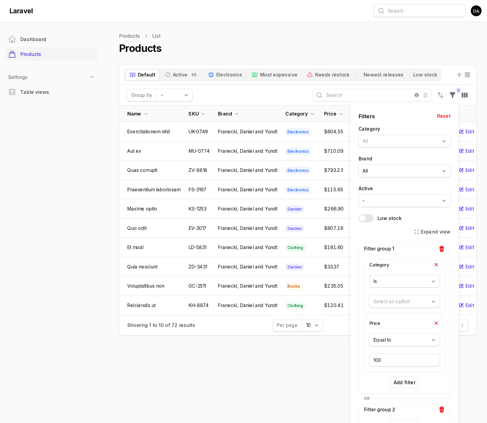
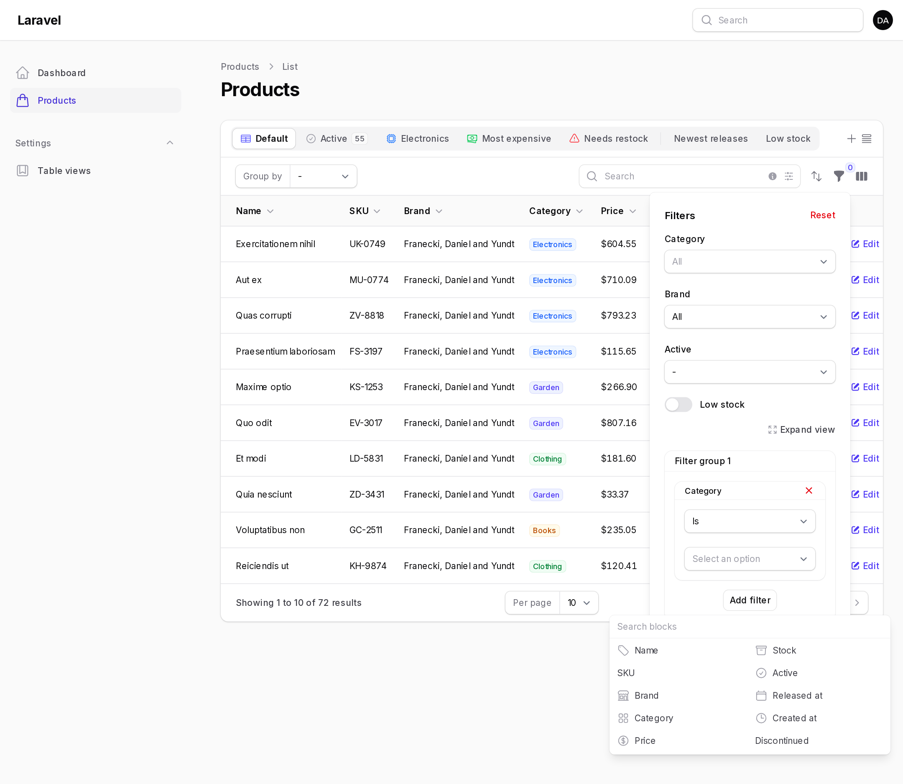
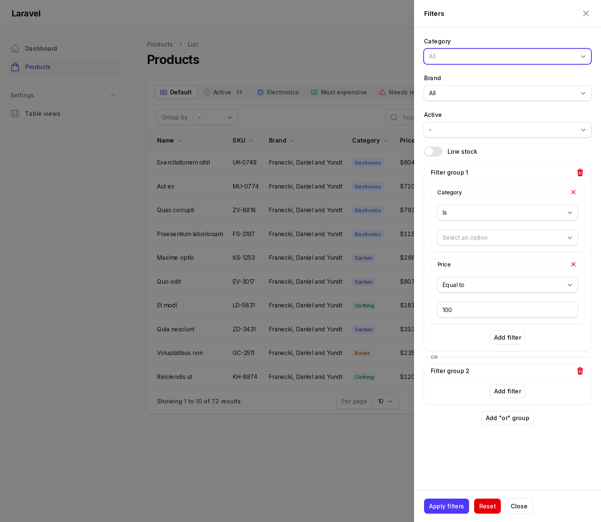

# Advanced Filter Builder

The advanced filter builder lets users build their own filters from the table's columns. Users pick filters from a filter picker, add each filter as many times as they need, and combine them in groups.



- Every filter in a group must match (AND).
- A record matching any group is shown (OR).

## Adding the builder

Add `AdvancedFilter` to the table's filters:

```php
use KaraOdin\FilamentDynamicTables\Filters\AdvancedFilter;

public function table(Table $table): Table
{
    return $table
        ->columns([...])
        ->filters([
            AdvancedFilter::make(),
        ]);
}
```

The builder appears in the table's filters panel, next to the table's other filters. Its filter name is `advanced_filter_builder`.

Users add filters from the filter picker:



## Generated filters

A filter is generated for each column of the table:

| Column | Filter |
| --- | --- |
| `TextColumn` with `->date()` or `->dateTime()`, columns with a date cast | `DateFilter` |
| `TextColumn` with `->numeric()` or `->money()`, columns with a number cast, `->counts()`, `->avg()`, `->sum()`, `->min()`, `->max()` | `NumericFilter` |
| `SelectColumn`, columns with a backed enum cast | `SelectFilter` |
| `ToggleColumn`, `CheckboxColumn`, boolean `IconColumn`, columns with a boolean cast | `BooleanFilter` |
| Other `IconColumn` and `ImageColumn` | is empty / is not empty |
| Other `TextColumn` | `TextFilter` |

Relationship columns such as `brand.name` filter through the relationship. Aggregate columns filter on the aggregate value.

Hidden columns are excluded unless `->includeHiddenColumns()` is called.

## Operators

| Filter | Operators |
| --- | --- |
| `TextFilter` | is, is not, contains, does not contain, starts with, does not start with, ends with, does not end with, is empty, is not empty |
| `NumericFilter` | equal to, not equal to, greater than, greater than or equal to, less than, less than or equal to, between, not between, is positive, is negative, is empty, is not empty |
| `DateFilter` | today, yesterday, tomorrow, in the last, not in the last, in the next, not in the next, exactly ago, exactly from now, this, last, next, is on, before, after, between, not between, is empty, is not empty |
| `SelectFilter` | is, is not, is empty, is not empty |
| `BooleanFilter` | is true, is false, is empty, is not empty |

Relative date operators take a value and a unit: days, weeks, months, quarters or years. For example "in the last 3 months" or "this quarter".

With `->options()` or `->relationship()`, the "is" and "is not" operators of a `TextFilter` use a select field.

Operator constants are available on `TextOperator`, `NumericOperator`, `DateOperator` and `BooleanOperator` in the `KaraOdin\FilamentDynamicTables\Filters\Operators` namespace.

## Customizing filters

Pass filters to `->filters()`:

- A filter with the same name as a column replaces the generated filter.
- Any other filter is added to the picker. This includes regular Filament filters.

Filters in the table's own `->filters()` stay outside the builder.

```php
use Filament\Tables\Filters\Filter;
use KaraOdin\FilamentDynamicTables\Filters\AdvancedFilter;
use KaraOdin\FilamentDynamicTables\Filters\DateFilter;
use KaraOdin\FilamentDynamicTables\Filters\NumericFilter;
use KaraOdin\FilamentDynamicTables\Filters\Operators\DateOperator;
use KaraOdin\FilamentDynamicTables\Filters\SelectFilter;
use KaraOdin\FilamentDynamicTables\Filters\TextFilter;

AdvancedFilter::make()
    ->filters([
        NumericFilter::make('shipping_price'),
        TextFilter::make('customer.name')
            ->relationship(name: 'customer', titleAttribute: 'name')
            ->multiple()
            ->preload(),
        TextFilter::make('currency')
            ->options(fn () => Currency::pluck('name', 'code')),
        SelectFilter::make('status')
            ->options(OrderStatus::class),
        DateFilter::make('created_at')
            ->excludeOperators([DateOperator::TOMORROW])
            ->defaultOperator(DateOperator::TODAY),
        Filter::make('is_active')
            ->query(fn (Builder $query) => $query->where('is_active', true))
            ->toggle(),
    ])
```

### Column filter methods

| Method | Description |
| --- | --- |
| `label()` | The label in the picker and the indicator. |
| `icon()` | The icon in the picker. |
| `attribute()` | The database column, when it differs from the filter name. |
| `queriesRelationship()` | The relationship to filter through. |
| `includeOperators([...])` | Offers only these operators. |
| `excludeOperators([...])` | Removes these operators. |
| `defaultOperator()` | The operator selected when the filter is added. |
| `options()`, `relationship()`, `multiple()`, `preload()`, `searchable()` | Options for `TextFilter` and `SelectFilter`. |

Closures receive `$filter`.

### Configuring all filters of a type

Configure every filter of a type in a service provider:

```php
use KaraOdin\FilamentDynamicTables\Filters\Operators\TextOperator;
use KaraOdin\FilamentDynamicTables\Filters\TextFilter;

TextFilter::configureUsing(fn (TextFilter $filter) => $filter->defaultOperator(TextOperator::CONTAINS));
```

To change generated filters on a single builder, use `modifyGeneratedFilterUsing()`:

```php
AdvancedFilter::make()
    ->modifyGeneratedFilterUsing(fn (ColumnFilter $filter, Column $column) => $filter->icon('heroicon-m-bolt'))
```

## Builder options

```php
AdvancedFilter::make()
    ->includeColumns(['status', 'currency', 'customer.name', 'created_at'])
    ->defaultFilters([['status'], ['status']])
    ->orGroups(false)
    ->icons(['status' => 'heroicon-o-clock', 'created_at' => 'heroicon-o-calendar'])
    ->filterPickerSearch()
    ->filterPickerColumns(2)
    ->filterPickerWidth('md')
    ->filterPickerMaxHeight('240px')
    ->prependFilterGroupLabels(prependFilterGroupLabelWhenSoleGroup: true)
    ->indicatorColors(['info', 'success'])
    ->expandViewLink(false)
```

| Method | Description |
| --- | --- |
| `filters([...])` | Custom and additional filters. |
| `includeColumns([...])` | Generates filters only for these columns. |
| `excludeColumns([...])` | Generates no filters for these columns. |
| `includeHiddenColumns()` | Also generates filters for hidden columns. |
| `defaultFilters([...])` | The filters shown in each group before the user changes anything, one array per group. `[]` shows none. By default, the filters passed to `->filters()` are shown in one group. |
| `orGroups(false)` | Uses a single group. |
| `icons([...])` | Icons per filter name. |
| `filterPickerSearch()` | Adds a search field to the picker. |
| `filterPickerColumns()` | The number of picker columns, or an array per breakpoint such as `['sm' => 2]`. |
| `filterPickerWidth()` | The picker width. |
| `filterPickerMaxHeight()` | The picker's maximum height. |
| `prependFilterGroupLabels()` | Prefixes indicators with "Filter group N". `prependFilterGroupLabelWhenSoleGroup` also prefixes them when there is one group. |
| `indicatorColors([...])` | Indicator colors per group. The default is primary, info, gray, success, danger, warning. |
| `expandViewLink(false)` | Removes the Expand view link. |

## Indicators

Every filter rule gets its own indicator. Indicators are prefixed with "Filter group N" when there are several groups, and are colored per group. Removing an indicator removes only that rule.

## Expand view

With the dropdown filters layout, the builder shows an **Expand view** link. It reopens the filters in a slide-over with more room.



Position the link with:

```php
DynamicTablesPlugin::make()->filterBuilderExpandViewStyles(['right: 100px', 'top: 24px'])
```

To always open the filters in a slide-over:

```php
$table
    ->filtersFormWidth('md')
    ->filtersTriggerAction(fn (Action $action) => $action->slideOver())
```

## Saving and presets

The builder state is saved in user views. Preset views set it with a short form, one array per group, keyed by filter name:

```php
PresetView::make('Recent or cancelled')->defaultFilters([
    'advanced_filter_builder' => [
        [
            'status' => ['value' => 'new'],
            'created_at' => ['operator' => 'in_the_last', 'value' => 1, 'unit' => 'months'],
        ],
        [
            'status' => ['value' => 'cancelled'],
        ],
    ],
])
```

The preset above shows new orders created in the last month, or cancelled orders.

## State shape

The full state, as stored in user views, is:

```php
[
    'or_groups' => [
        '<uuid>' => [
            'filters' => [
                '<uuid>' => ['type' => 'status', 'data' => ['operator' => 'is', 'value' => 'new']],
            ],
        ],
    ],
]
```

Use the short form in code. It is normalized to this shape when applied.
