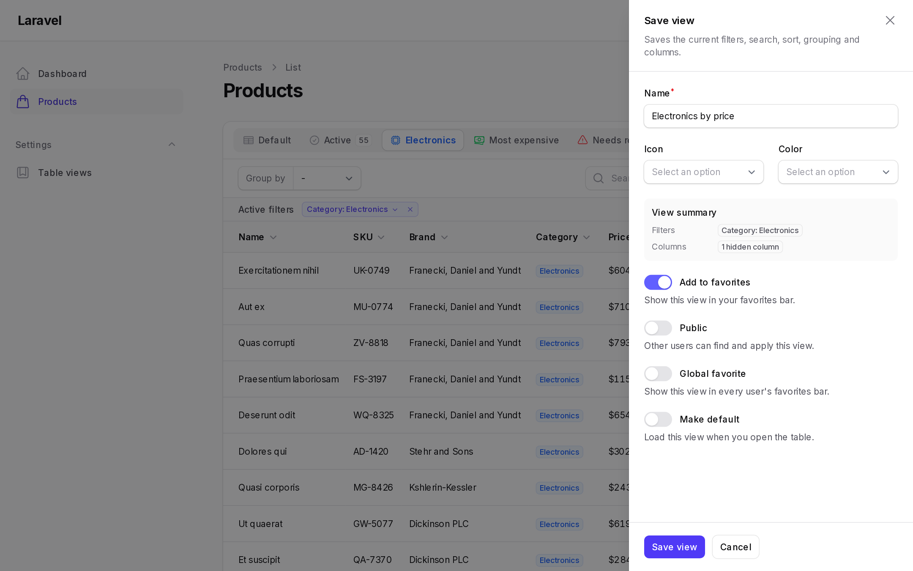

# Quick Save

Quick save stores the current table state as a new user view. The button opens a slide-over with the following fields:

- **Name**, required
- **Icon** and **Color**, when the pickers are enabled
- **View summary**, a read-only list of the filters, search, sort, grouping and columns that will be saved
- **Add to favorites**
- **Public**, which lists the view for other users
- **Global favorite**, which adds the view to every user's favorites bar
- **Make default**, when [managed default views](managed-default-views.md) are enabled



## Placement

```php
DynamicTablesPlugin::make()
    // In the favorites bar, at the start or the end
    ->quickSaveInFavoritesBar(icon: 'heroicon-o-bookmark', position: 'start')

    // Or in the table toolbar
    ->quickSaveInFavoritesBar(false)
    ->quickSaveInTable()
```

## Options

| Method | Default | Description |
| --- | --- | --- |
| `quickSaveEnabled()` | `true` | Shows the quick save button. |
| `quickSaveInFavoritesBar(condition, icon, position)` | `true`, `end` | Places the button in the favorites bar. |
| `quickSaveInTable()` | `false` | Places the button in the table toolbar. |
| `quickSaveSlideOver()` | `true` | Opens the form in a slide-over. `false` uses a modal. |
| `quickSaveTriggerAction()` | | Customizes the trigger action. See [Action customization](../configuration/action-customization.md). |
| `quickSaveIconSelect()` | `true` | Shows the icon picker. |
| `quickSaveIncludeOutlineIcons()` | `true` | Includes outline Heroicons. |
| `quickSaveIncludeSolidIcons()` | `true` | Includes solid Heroicons. |
| `quickSaveColorPicker()` | `true` | Shows the color picker. |
| `quickSaveColors()` | six Filament colors | The colors offered. |
| `quickSaveMakeFavorite()` | `true` | Shows the **Add to favorites** toggle. |
| `quickSaveFavoriteByDefault()` | `true` | Turns the favorites toggle on by default. |
| `quickSaveMakePublic()` | `true` | Shows the **Public** toggle. |
| `quickSavePublicByDefault()` | `false` | Turns the public toggle on by default. |
| `quickSaveMakeGlobalFavorite()` | `false` | Shows the **Global favorite** toggle. |

## Helper texts

Each field can show a helper text below it.

| Method | Default |
| --- | --- |
| `quickSaveNameHelperText()` | `false` |
| `quickSaveFiltersHelperText()` | `false` |
| `quickSavePublicHelperText()` | `true` |
| `quickSaveFavoriteHelperText()` | `true` |
| `quickSaveGlobalFavoriteHelperText()` | `true` |
| `quickSaveActivePresetViewHelperText()` | `false` |

## Saving from a preset view

When the user saves while a preset view is active, the new view remembers the preset, and the preset's query modification still applies when the view is opened. With `createUsingPresetView(false)`, saving is refused while a preset with a query modification is active, and the user is notified instead.

## Disabling quick save for a table

```php
public static function quickSaveIsEnabled(): bool
{
    return false;
}
```
