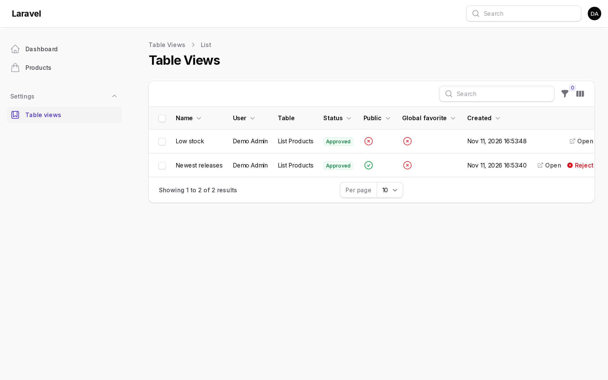

# User Views Resource

The user views resource is a Filament resource where administrators browse, approve, reject, edit and delete every user view.



The resource is disabled by default:

```php
DynamicTablesPlugin::make()
    ->resourceEnabled()
    ->resourceNavigationGroup('Settings')
    ->resourceNavigationIcon('heroicon-o-star')
    ->resourceNavigationSort(1)
    ->resourceNavigationBadge(false)
    ->resourceLoadAllUsers(false)
    ->resourcePanels(['admin', 'sales'])
    ->canAccessUserViewsResourceUsing(fn (User $user) => $user->is_admin)
    ->userViewsResourceClass(MyUserViewResource::class)
```

## Options

| Method | Default | Description |
| --- | --- | --- |
| `resourceEnabled()` | `false` | Registers the resource. |
| `resourceNavigationGroup()` | `null` | The navigation group. |
| `resourceNavigationIcon()` | `heroicon-o-bookmark-square` | The navigation icon. |
| `resourceNavigationSort()` | `null` | The navigation sort order. |
| `resourceNavigationBadge()` | `true` | Shows the number of shared views pending approval. |
| `userViewsNavigationLabel()` | `User views` | The navigation label. |
| `userViewsSlug()` | `dynamic-table-views` | The URL slug. |
| `resourceLoadAllUsers()` | `true` | Preloads users in the owner filter. Set to `false` to search users instead. |
| `resourcePanels([...])` | `null` | Also lists views created in these panels. |
| `canAccessUserViewsResourceUsing()` | | A closure that decides access, in addition to the policy. |
| `userViewsResourceClass()` | `UserViewResource` | Replaces the resource with your own subclass. |

## Table

The resource lists every view with its owner, table, status, and public and global flags. Click the public or global icon to toggle the flag.

By default it shows the views of the current panel and views created without a panel.

## Actions

| Action | Description |
| --- | --- |
| Open | Opens the view's table with the view applied, using `?table_view=user:{id}`. |
| Approve, Reject | Changes the approval status. Available as row and bulk actions. |
| Edit | Changes the name, icon, color, sharing flags and status. |
| Delete | Deletes the view. Available as a row and bulk action. |

## Access

Access goes through the `viewAny` ability of the user view policy. Without a custom policy, any user with panel access can browse the resource, and owners can manage only their own views. Register a policy before enabling the resource. See [Authorization](../configuration/authorization.md).

## Standalone Table Builder

Outside a panel, route to the included Livewire component:

```php
use KaraOdin\FilamentDynamicTables\Livewire\ListUserViews;

Route::get('/user-views', ListUserViews::class)->middleware(['auth']);
```
